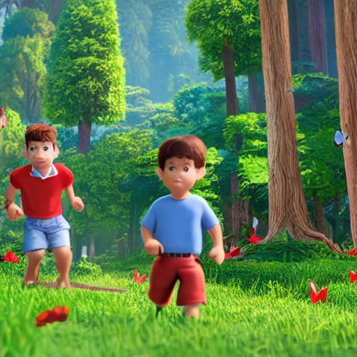
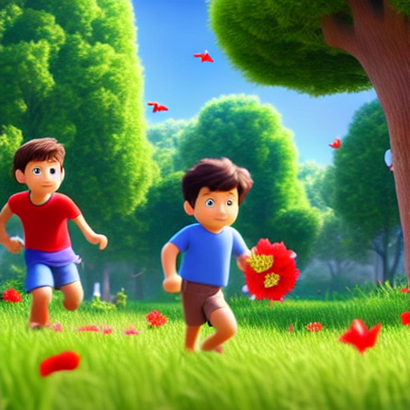
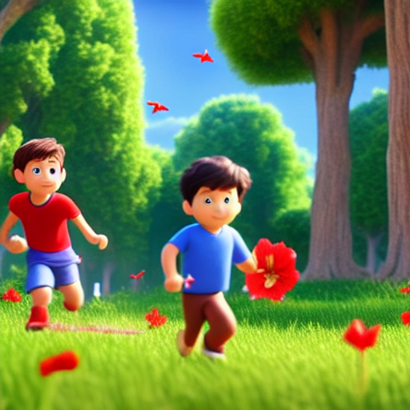
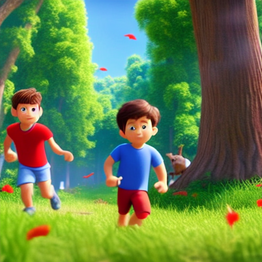

# Story2Video – Generative AI

**Turn a narrated story into a short animated video.**

Story2Video is a Python-based Generative AI pipeline that transforms an uploaded story recording into a short animated video. It transcribes the narration, plans four scenes, generates scene images, animates those images, and combines the clips with the original audio.

## Demo

**Final generated video:** [Watch the Story2Video demo](assets/videos/story2video_demo.mp4)

- Video format: MP4 (H.264 video + AAC audio)
- Resolution: 1024 × 576
- Duration: approximately 15.9 seconds

## Generated scene images

The following images are example outputs generated by the project.

| Scene 1 | Scene 2 |
|---|---|
|  |  |
| **Scene 3** | **Scene 4** |
|  |  |

## Project workflow

```text
Story audio
    |
    v
Whisper Small – speech transcription
    |
    v
Qwen 2.5 3B Instruct – four-scene planning
    |
    v
Stable Diffusion 1.5 – scene image generation
    |                   |
    |                   +-- Optional IP-Adapter for visual consistency
    v
Stable Video Diffusion XT – image-to-video animation
    |
    v
MoviePy – combine clips and original narration
    |
    v
Final story video
```

## Features

- Upload a story recording through a Gradio interface.
- Transcribe speech using OpenAI Whisper (`small` model).
- Use Qwen 2.5 3B Instruct to plan four consecutive scenes.
- Create a reusable character description for the scenes.
- Generate 512 × 512 scene images with Stable Diffusion 1.5.
- Optionally use IP-Adapter to help preserve visual consistency.
- Animate each image using Stable Video Diffusion XT.
- Combine scene clips with the original narration using MoviePy.
- Use CUDA memory cleanup and progressively smaller video-generation settings to handle GPU memory limits.
- Fall back to transcript-based scene splitting if Qwen scene planning fails.

## Models

| Component | Model |
|---|---|
| Speech recognition | OpenAI Whisper (`small`) |
| Scene planning | `Qwen/Qwen2.5-3B-Instruct` |
| Image generation | `stable-diffusion-v1-5/stable-diffusion-v1-5` |
| Optional image consistency | `h94/IP-Adapter` |
| Image-to-video | `stabilityai/stable-video-diffusion-img2vid-xt` |

Model weights are downloaded by the respective libraries when first used. They are **not** included in this repository.

## Technology stack

- Python
- PyTorch
- OpenAI Whisper
- Hugging Face Transformers
- Hugging Face Diffusers
- Stable Diffusion
- Stable Video Diffusion
- IP-Adapter
- Gradio
- Pillow
- MoviePy

## Repository structure

```text
Story2Video-Generative-AI/
├── README.md
├── story2video.py
├── requirements.txt
├── .gitignore
└── assets/
    ├── images/
    │   ├── scene_1.png
    │   ├── scene_2.png
    │   ├── scene_3.png
    │   └── scene_4.png
    └── videos/
        └── story2video_demo.mp4
```

## Requirements

- Python environment compatible with the installed PyTorch, Transformers, and Diffusers versions.
- NVIDIA GPU with CUDA support. The script checks for CUDA and stops if no GPU is available.
- Sufficient GPU memory. The script attempts smaller video resolutions and frame counts if an out-of-memory error occurs.
- Internet access on the first run to download model weights.
- FFmpeg available in the environment for audio/video processing.

The implementation was developed for a Kaggle GPU workflow, including a Tesla T4 environment. Exact package versions may need adjustment for the CUDA runtime and model-library compatibility.

## Installation

Clone the repository:

```bash
git clone https://github.com/bruce17022006/Story2Video-Generative-AI.git
cd Story2Video-Generative-AI
```

Install dependencies:

```bash
pip install -r requirements.txt
```

Install a PyTorch build compatible with your CUDA runtime if the default installation is not suitable. Also ensure FFmpeg is available.

## Run the application

The script is designed for a GPU-enabled environment such as Kaggle. Run:

```bash
python story2video.py
```

The Gradio interface launches with a shareable link. Upload a story audio recording, optionally describe the main character, and select **Make my video**.

The interface provides:
- The final generated video.
- The generated scene images.
- The recognized transcript, character description, and scene actions.

> **GPU requirement:** Enable a CUDA GPU before running. The first run can take time because the model weights need to be downloaded and loaded.

## Important limitations

- The pipeline currently creates exactly four scenes.
- Character consistency is not guaranteed. IP-Adapter is optional; if it is unavailable or fails, the pipeline falls back to text prompts and a fixed seed.
- Video generation can still run out of GPU memory, even with the fallback settings.
- The fallback scene planner divides the transcript into text chunks; it does not perform semantic scene understanding.
- Successful SQL/database execution is not relevant to this project; the application generates a video.
- The Gradio app uses `share=True`, which creates a public share link. Do not upload private or sensitive audio. Disable public sharing if adapting the code for private use.

## Future improvements

- Support a configurable number of scenes and scene durations.
- Improve visual consistency of the main character across generated scenes.
- Add configurable video quality and generation settings.
- Add broader input validation and clearer per-stage error reporting.
- Provide tested, pinned dependency versions and reproducible setup instructions.
- Evaluate outputs using multiple narration samples.

## Author

**Purushothaman V**  
B.Tech – Artificial Intelligence and Data Science  
Mepco Schlenk Engineering College, Sivakasi

- GitHub: [@bruce17022006](https://github.com/bruce17022006)

---

If you find this project interesting, feel free to explore the code and share feedback.
